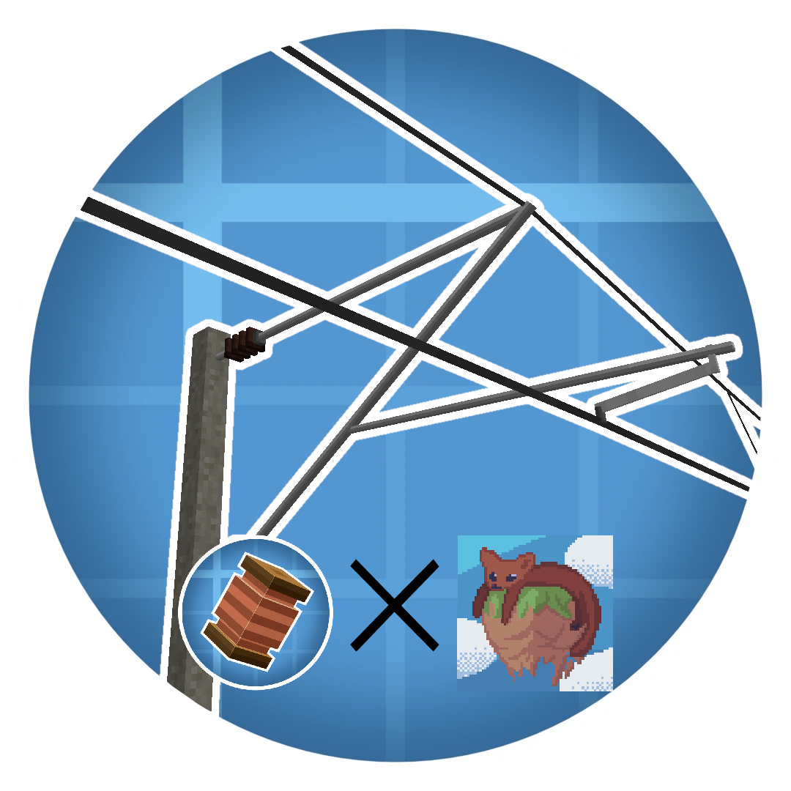

<p align="center"></p>

# P&W Sable Fix 1.5.0

**让接触网真正为你的物理列车供电。**

面向 **Minecraft 1.21.1 NeoForge** 的铁路电气兼容附属，连接 Pantographs & Wires、Sable 与 Create Electro Energetics，为移动物理列车提供红石升降弓、真实接触网取电和随车电弧音效。

## 功能

- P&W 与原生 CEE 受电弓：有红石信号升弓，无信号降弓。
- Sable 物理结构上的 P&W 受电弓按车体位姿检测接触网，从 P&W 或 CEE 线网取电。
- P&W 接触线、馈线参与 CEE 电路仿真，可向车载电气负载供电。
- 多腕臂横排独立端子，支持分别供电；线缆绝缘子支持分段隔离。
- 接触、脱离带电线网时播放不同长度的电弧声，音源跟随车体移动。
- 可选搭配 EMU Cab，支持03/06车受电弓登记、VCB控制及真实网压、网流反馈。
- 保留1.4.5的行驶换线段遥测同步修复。

## 安装与依赖

客户端、服务端均安装 **pwsablefix-1.5.0.jar**，并移出旧版同名附属。需要 Java 21。

| 组件 | 推荐的已验证版本 |
| --- | --- |
| Minecraft | 1.21.1 |
| NeoForge | 21.1.242（本轮测试基线；允许更高21.1.x） |
| Create | 6.0.10 |
| Pantographs & Wires | 1.21.1-beta-0.2.3-C6 |
| Sable | 2.0.6 |
| Create Electro Energetics | 1.21.1-1.2.0-127 |
| DragonLib | 3.0.29 |
| GeckoLib | 4.9.3 |

正式版对 P&W、Sable、CEE 采用精确版本约束；其他允许范围和内置库说明见 [依赖与安装](docs/依赖与安装.md)。Sable Companion、Veil、Flywheel、Ponder、Architectury等由相应前置内置，不需重复下载。本版要求的GeckoLib 4.9.3高于P&W内置版本，需要另装。

**EMU Cab、Simurail、DriveByWire、DriveBySable不是必装依赖。** EMU Cab仅用于可选驾驶台联动。独立渐变电机、转向架VVVF音效由EMU Cab提供。

[下载正式版](https://github.com/yasui-i/pw-sable-fix-1.21.1/releases/latest) · [完整模组介绍](docs/模组介绍.md) · [反馈问题](https://github.com/yasui-i/pw-sable-fix-1.21.1/issues)

## 使用

用CEE线轴接通电源与P&W接线器或腕臂端子，再用P&W馈线、接触线构成供电线路。受电弓端子、车载负载与回流线路须组成闭合回路。施加红石信号后升弓接触带电导线；若已登记到驾驶台，需合上VCB。

升弓不保证取电，电压不代表一定有负载电流。绝缘子只切断该处连续导电，独立电源或旁路仍可能使另一侧带电。原生CEE受电弓仍从CEE线网取电，本附属为其增加红石升降控制。

配置：`config/pwsablefix-common.toml`，默认启用红石控制、物理结构接触检测和CEE桥接。

## 从源码构建

JDK 21，先按 [本地依赖说明](libs/README.md) 准备第三方JAR，再执行：

```shell
./gradlew build
```

Windows使用 `./gradlew.bat build`。产物：`build/libs/pwsablefix-1.5.0.jar`。首次构建需要联网获取Gradle、NeoForge及映射。第三方模组JAR不提交到本仓库，也不会打包进发行物。

GitHub Actions运行触网音效状态检查；真实CEE求解器与Sable物理体回归入口为 `tools/check-multiarm.gradle`、`tools/check-moving-electrical.gradle`。测试须在隔离实例中准备运行依赖，不能用于玩家存档。传入 `-PpackagedModTest` 可关闭源码模组注入，测试放在测试实例mods中的正式JAR；用 `-PtestGameDir=...` 指定隔离目录。

[开发历史与旧版测试记录](docs/开发历史.md)。旧章节中的版本号、路径和安装要求仅记录当时状态；`tools/motor-harness` 为电机迁移前历史工具，当前电机验证应使用EMU Cab项目。

## 致谢与许可

感谢 P&W、Sable、CEE、Create及相关前置模组作者。Logo由项目作者提供，组合使用各前置的图标元素；原图标归各自作者所有。游戏电弧音效直接调用已安装CEE的资源，本附属不重新发布其音频文件。

本项目为独立兼容附属，许可保持 **All Rights Reserved**；`TEMPLATE_LICENSE.txt`仅适用于NeoForge MDK模板部分。公开源码不代表授予第三方素材的再许可。
